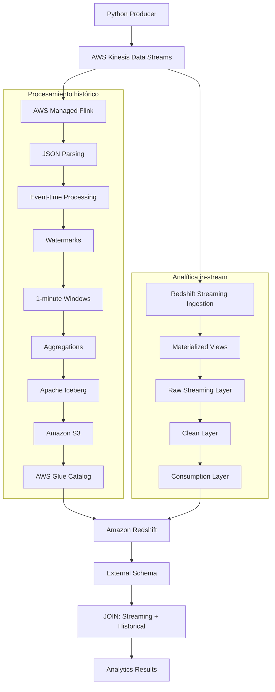

# Pre-entrega 6 – Analítica avanzada in-stream con Amazon Redshift

## Descripción

Implementación de una arquitectura de procesamiento y analítica de datos financieros en tiempo real utilizando AWS Kinesis Data Streams, Amazon Managed Service for Apache Flink, Apache Iceberg, AWS Glue Data Catalog y Amazon Redshift.

El sistema recibe cotizaciones bursátiles generadas mediante un producer en Python. Los eventos se procesan mediante dos flujos complementarios:

- **Procesamiento histórico:** Apache Flink consume los eventos de Kinesis, calcula agregaciones por ticker en ventanas de un minuto y almacena los resultados en una tabla Apache Iceberg sobre Amazon S3.
- **Analítica in-stream:** Amazon Redshift consume directamente los eventos de Kinesis mediante Streaming Ingestion, sin utilizar S3 como intermediario. Sobre esta ingesta se construyen vistas materializadas para consultar y agregar los datos recientes.

Finalmente, Redshift integra los datos recientes con las agregaciones históricas almacenadas en Iceberg, consultando el catálogo Glue mediante un esquema externo.

La infraestructura se administra mediante Terraform y el proyecto es autónomo: no requiere desplegar la infraestructura de la Pre-entrega 5.

## Arquitectura



## Tecnologías

- Python 3
- boto3
- Java
- Apache Maven
- Apache Flink 1.20
- Apache Iceberg 1.7.1
- AWS Kinesis Data Streams
- AWS Managed Service for Apache Flink
- Amazon Redshift
- Redshift Streaming Ingestion
- Redshift Materialized Views
- AWS Glue Data Catalog
- Amazon S3
- Amazon Athena
- AWS IAM
- Amazon CloudWatch
- Terraform

## Estructura del proyecto

```text
Pre-entrega_6_analitica_avanzada_in-stream_con_Redshift/
│
├── app/
│   ├── src/
│   │   └── main/
│   │       └── java/
│   │           └── com/dataeng/lakehouse/
│   │               ├── IcebergTableManager.java
│   │               ├── StockAccumulator.java
│   │               ├── StockAggregate.java
│   │               ├── StockAggregateFunction.java
│   │               ├── StockAggregateToRowDataMapper.java
│   │               ├── StockLakehouseJob.java
│   │               ├── StockQuote.java
│   │               ├── StockQuoteParser.java
│   │               └── StockWindowFunction.java
│   └── pom.xml
│
├── evidencia.zip
│   └── Capturas de funcionamiento, integración,
│       seguridad y monitoreo.
│
├── infra/
│   ├── backend.tf
│   ├── cloudwatch.tf
│   ├── flink.tf
│   ├── glue.tf
│   ├── iam.tf
│   ├── kinesis.tf
│   ├── network.tf
│   ├── outputs.tf
│   ├── provider.tf
│   ├── redshift.tf
│   ├── s3.tf
│   ├── variables.tf
│   ├── version.tf
│   └── terraform.tfvars.example
│
├── producer/
│   └── producer.py
│
├── sql/
│   ├── 01_ingest.sql
│   ├── 02_clean_layer.sql
│   ├── 03_consumer.sql
│   ├── 04_lakehouse.sql
│   ├── 05_security.sql
│   └── 06_monitoring.sql
│
├── requirements.txt
├── .gitignore
└── README.md
```

## Producer

El producer desarrollado en Python genera cotizaciones aleatorias para los tickers AAPL, MSFT, GOOGL y AMZN.

Cada evento contiene:

- `TICKER`: símbolo bursátil.
- `PRICE`: precio generado.
- `EVENT_TIME`: timestamp UTC en formato ISO 8601.

Los eventos se envían a Kinesis mediante `put_records`, utilizando el ticker como partition key.

Configuración de generación:

- 20 eventos por lote.
- Intervalo de 2 segundos entre lotes.

### Ejecución

Instalar las dependencias desde la raíz del proyecto:

```bash
pip install -r requirements.txt
```

Configurar las credenciales AWS mediante un perfil local o variables de entorno.

Ejecutar:

```bash
python producer/producer.py
```

Presionar `Ctrl+C` para detener el producer.

## Procesamiento histórico con Flink

La aplicación Java consume eventos desde Kinesis Data Streams y realiza:

1. Deserialización de eventos JSON.
2. Conversión de los eventos a objetos `StockQuote`.
3. Asignación de timestamps y watermarks.
4. Agrupación por ticker.
5. Ventanas temporales de un minuto.
6. Cálculo de agregaciones:
   - Cantidad de operaciones (`trade_count`).
   - Precio promedio (`avg_price`).
   - Precio máximo (`max_price`).
   - Precio mínimo (`min_price`).

Los resultados se convierten a `RowData` y se escriben en Apache Iceberg mediante `FlinkSink` en modo append.

### Almacenamiento con Iceberg

La aplicación utiliza `IcebergTableManager` para crear la tabla si todavía no existe, utilizando Glue Catalog como catálogo y Amazon S3 como almacenamiento.

Configuración:

- Glue Database: `stock_lakehouse_dev`.
- Iceberg Table: `stock_aggregations`.
- Storage: Amazon S3.
- File format: Parquet.
- Partitioning: `days(window_start)`.

Esquema de la tabla:

| Campo | Tipo |
|---|---|
| `ticker` | String |
| `window_start` | Timestamp |
| `window_end` | Timestamp |
| `trade_count` | Long |
| `avg_price` | Double |
| `max_price` | Double |
| `min_price` | Double |

Los metadatos de la tabla se registran en AWS Glue Data Catalog y los datos se almacenan en S3.

## Analítica in-stream con Amazon Redshift

Redshift consume directamente los eventos de Kinesis Data Streams mediante Streaming Ingestion, sin utilizar Amazon S3 como intermediario.

El proceso se organiza en tres capas:

### 1. Raw Streaming Layer

Se crea un esquema externo sobre Kinesis y una vista materializada que recibe los registros del stream.

Se utiliza `JSON_PARSE` para convertir los eventos JSON a tipo `SUPER`, validando previamente su estructura mediante `CAN_JSON_PARSE`.

La vista materializada raw utiliza actualización automática (`AUTO REFRESH YES`).

### 2. Clean Layer

Se extraen los campos JSON y se convierten a tipos de datos nativos:

- `TICKER`: identificador del activo.
- `EVENT_TIME`: timestamp del evento.
- `PRICE`: precio de cotización.

También se implementa una lógica de deduplicación mediante `ROW_NUMBER()`.

### 3. Consumption Layer

Se construye una vista materializada con agregaciones por ticker y minuto:

- Cantidad de registros.
- Suma de precios.
- Precio promedio.

Debido a que la expresión `DATE_TRUNC` no admite actualización automática en esta definición, se utiliza una estrategia de refresco manual mediante `REFRESH MATERIALIZED VIEW`.

## Integración entre Redshift e Iceberg

Redshift se conecta al Glue Data Catalog mediante un esquema externo denominado `lake`.

La vista `analytics_consumption.stock_quotes_vs_historico` combina:

- Las agregaciones recientes obtenidas desde Kinesis mediante Redshift Streaming Ingestion.
- Las agregaciones históricas almacenadas en la tabla Iceberg `stock_aggregations`.

El JOIN se realiza utilizando el campo `ticker`.

Se calculan las siguientes métricas:

- Precio promedio reciente.
- Precio promedio histórico.
- Precio máximo histórico.
- Precio mínimo histórico.
- Desvío entre el promedio reciente y el histórico.

La vista se define como *late-binding view* mediante `WITH NO SCHEMA BINDING`, permitiendo consultar la tabla externa de Iceberg desde Redshift.

## Seguridad y control de acceso

La infraestructura utiliza roles IAM para permitir la comunicación entre los servicios AWS.

El rol asociado a Redshift dispone de permisos para:

- Consultar Kinesis Data Streams.
- Acceder al Glue Data Catalog.
- Leer los objetos históricos almacenados en S3.

En Redshift se implementa control de acceso basado en roles (RBAC).

Se crean los siguientes roles:

- `analytics_rt`: acceso de lectura a la capa de consumo.
- `analytics_ar`: acceso de uso al esquema de consumo.

También se revoca el acceso público al esquema `raw_streaming`.

## Monitoreo

Se utilizan las vistas de sistema de Amazon Redshift para monitorear la ingesta y las vistas materializadas.

Las consultas implementadas permiten:

1. Consultar el historial de actualización de las vistas materializadas mediante `SYS_MV_REFRESH_HISTORY`.
2. Monitorear la lectura del stream por shard mediante `SYS_STREAM_SCAN_STATES`.
3. Detectar errores de ingesta mediante `SYS_STREAM_SCAN_ERRORS`.
4. Medir la frescura de los datos mediante la diferencia temporal entre la llegada del último registro y el momento de consulta.

## Estructura de los scripts SQL

Los scripts se encuentran en la carpeta `sql/` y deben ejecutarse en el siguiente orden:

| Archivo | Descripción |
|---|---|
| `01_ingest.sql` | Configuración de Streaming Ingestion y vista materializada raw. |
| `02_clean_layer.sql` | Extracción, tipado y deduplicación de los eventos JSON. |
| `03_consumer.sql` | Agregaciones por ticker y minuto. |
| `04_lakehouse.sql` | Integración mediante JOIN entre Redshift e Iceberg. |
| `05_security.sql` | Creación de roles y asignación de privilegios. |
| `06_monitoring.sql` | Consultas de monitoreo y diagnóstico. |

Los scripts se ejecutan desde Amazon Redshift Query Editor v2, utilizando la base de datos `analytics`.

## Infraestructura con Terraform

La infraestructura se administra mediante Terraform y utiliza la región `us-east-2`.

Los recursos principales incluyen:

- Amazon Kinesis Data Streams.
- Amazon Managed Service for Apache Flink.
- Amazon Redshift.
- Amazon S3.
- AWS Glue Data Catalog.
- Roles y políticas IAM.
- Grupos de seguridad y componentes de red.
- Configuración de CloudWatch.

### Configuración inicial

Desde la carpeta `infra`, crear el archivo local de variables a partir del ejemplo:

```bash
cp terraform.tfvars.example terraform.tfvars
```

El repositorio incluye `terraform.tfvars.example` como plantilla de configuración. Antes de desplegar la infraestructura, se debe crear una copia local denominada `terraform.tfvars` y completar los valores correspondientes.

El archivo `terraform.tfvars` está excluido del control de versiones mediante `.gitignore`, por lo que no se publica en el repositorio. En cambio, `terraform.tfvars.example` sí está versionado y permite identificar las variables necesarias para configurar el entorno.


### Compilación de la aplicación Flink

Desde la carpeta `app`:

```bash
mvn clean package
```

El JAR generado se utiliza como artefacto de la aplicación Flink.

### Despliegue

Desde la carpeta `infra`:

```bash
terraform init
terraform plan
terraform apply
```

La aplicación Flink se crea detenida (`start_application = false`). Luego del despliegue, debe iniciarse desde Amazon Managed Service for Apache Flink.

### Ejecución del pipeline

El orden general de ejecución es:

1. Desplegar la infraestructura mediante Terraform.
2. Iniciar la aplicación Managed Flink.
3. Ejecutar el producer para enviar eventos a Kinesis.
4. Verificar la creación y alimentación de `stock_aggregations` mediante Glue y Athena.
5. Ejecutar los scripts SQL de Redshift en el orden indicado.
6. Validar las consultas de monitoreo y la integración entre streaming e histórico.

### Destrucción de recursos

Para evitar costos innecesarios, una vez finalizadas las pruebas ejecutar desde `infra`:

```bash
terraform destroy
```

Confirmar la operación cuando Terraform lo solicite.

## Validación

El funcionamiento del proyecto se verifica mediante:

- Recepción de eventos en Kinesis Data Streams.
- Ejecución de la aplicación Managed Flink.
- Procesamiento de cotizaciones y agregaciones por ventanas de un minuto.
- Creación y alimentación de la tabla Iceberg en Glue y S3.
- Consulta de los datos históricos mediante Athena.
- Ingesta directa desde Kinesis hacia Redshift.
- Extracción y conversión de campos JSON sin errores de casting.
- Agregaciones mediante Materialized Views.
- JOIN entre datos recientes de Redshift y datos históricos Iceberg.
- Implementación de roles y privilegios RBAC.
- Monitoreo de refrescos, lag, errores y frescura de datos.

## Evidencias

Las capturas de pantalla de la implementación se encuentran en la carpeta `evidencia/`.

Incluyen:

- Estado de Kinesis y Managed Flink.
- Datos históricos almacenados en Iceberg.
- Ingesta y vistas materializadas de Redshift.
- Integración Redshift e Iceberg.
- Metadatos de Glue.
- Configuración de seguridad RBAC.
- Consultas de monitoreo y frescura de datos.
